  <picture>
    <source media="(prefers-color-scheme: dark)" srcset="./assets/terminal-dark.svg" />
    
  </picture>

  
  

  

---

<h2 align="center">About Me</h2>

I'm César, a data scientist based in Mexico. My current focus is applied AI, and AI agents in particular: systems where a model goes beyond answering questions and completes the task by calling tools, querying a database or reading a file. Most of my independent work goes into building with LLMs and making agents reliable in real use, beyond a demo.

My background is in classical machine learning and optimization: predictive models, clustering, genetic algorithms and Markov chains. That foundation carries over directly to agents, because the work still comes down to data, evaluation and judging whether a result makes sense.

**Selected work**

- **AI agents**: A WhatsApp assistant that answers database questions in plain language, by text or voice note, with an animated mascot designed to give it a recognizable identity.
- **[Web scraping](https://github.com/CesarYamadaX/Scrapping)**: Tools that collect and organize public product and price data from online stores.
- **[Web applications](https://github.com/CesarYamadaX/foundation-management-system)**: A management system for a foundation that supports the deaf community in Mexico.
- **Side projects**: [Browser minigames](https://github.com/CesarYamadaX/Minigames) and a [simple chess engine](https://github.com/CesarYamadaX/simple-chess-engine).

**Areas of interest**

- **AI agents**: LLMs that use tools, connect to real data and automate the repetitive parts of a workflow, so people can spend their time on what requires judgment.
- **Machine learning**: Classification, regression and clustering on real, messy data.
- **Optimization and decision support**: Operations research, genetic algorithms and Markov chains applied to finding the best way to do something.

<h2 align="center">My Stack</h2>

  
   
  

  
  
  
  

<h2 align="center">Signals</h2>

  <picture>
    <source media="(prefers-color-scheme: dark)" srcset="./assets/signals-dark.svg" />
    
  </picture>

<h2 align="center">Contact</h2>

  If you are building with AI agents, LLMs or data, or would like to exchange ideas, write to me at <a href="mailto:cedayaxo@gmail.com">cedayaxo@gmail.com</a>.

---

<code>built with data · @CesarYamadaX</code>

